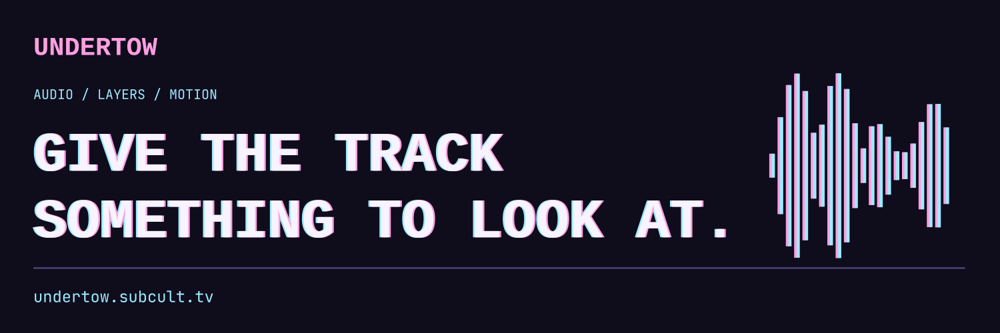

# Undertow



**Give the track something to look at.**

Undertow is a layered music visualizer editor that runs in your browser. Load a
song, stack visuals behind your artwork, put timed lyrics on top, and render an
MP4 for the full release or a short for the feed. The editor is public and needs
no account; accounts and cloud rendering are optional and still in testing.

Open the editor at <https://undertow.subcult.tv>. Product page:
<https://subcult.tv/products/undertow>.


## Features

- **Layers:** Milkdrop presets, spectrum, waveform, VU meters, particles,
  artwork and logos, text, socials, and looping video backgrounds. Stack them,
  blend them, hide the ones you don't want.
- **Lyrics:** LRC, SRT or VTT, with a sync offset. Enhanced LRC word timings
  give word-by-word karaoke.
- **Three frames from one project:** every layer keeps its own position in
  16:9, 9:16 and 1:1, so the landscape cut, the vertical and the square all come
  out of the same file.
- **Templates:** Classic, Vinyl, Karaoke, Neon, Poster and Video loop. Each one
  carries over your song, artwork, clip and lyrics.
- **Fonts:** six built in, or upload your own TTF, OTF, WOFF or WOFF2.
- Undo, snapping guides, browser autosave and layout save and load.

### It renders on your machine

A local export analyzes, draws and encodes the video in your browser. Your
audio doesn't leave it. Export the whole song or a 15-second preview as MP4,
from 720p to 4K at 24, 30 or 60 frames per second.

Codec support and render speed depend on your browser and hardware. The
exporter asks for H.264 first and falls back to HEVC, VP9 or AV1 if the browser
can't encode it. A browser without an audio encoder produces silent video and
says so in the export dialog. 4K is offered everywhere, but not every device can
encode it.

### Optional accounts and cloud rendering

Accounts (email and password, or Google and Discord sign-in) add a project
library, reusable artist defaults and API keys. Projects store layouts, not
media. Cloud rendering runs the same rendering code in a headless Chrome worker
on the server; it is in testing and live paid billing is off, so there is no
plan to buy. A cloud render uploads the files it needs and deletes those inputs
when the job ends.

## Quick start

You need Node 24 and npm. The editor runs on its own:

```sh
npm install
npm run dev        # editor on http://localhost:5173, no API needed
npm run build      # static site in dist/
npm test           # unit tests (Vitest)
```

With `npm run dev` running, open `/selftest.html` in a browser to check which
codecs it can encode and run real test exports.

To run the account API as well:

```sh
docker compose up -d db                  # Postgres on 127.0.0.1:5433
cp server/.env.example server/.env       # then fill in AUTH_SECRET
npm --prefix server ci
npm --prefix server run db:migrate
npm run api:dev                          # API on :8787; the Vite dev server proxies /v1 and /docs to it
```

Confirmation and reset links appear in the API log. For a local cloud render
worker, run `EDITOR_URL=http://localhost:5173 npm --prefix server run worker`
(it uses an installed Google Chrome).

API tests need Docker and the server dependencies:

```sh
bash scripts/test-with-postgres.sh       # creates a throwaway database, runs the API tests, removes it
```

You can also point `TEST_DATABASE_URL` at a disposable database whose name starts
with `undertow_test` and run `npm run test:integration`. The tests reset that
database.

## Configuration

The API reads environment variables. `server/.env.example` is the local
template; `deploy/undertow.env.example` is the production one.

| Variable | Purpose |
| --- | --- |
| `DATABASE_URL` | PostgreSQL connection string |
| `PUBLIC_URL` | Public origin; OAuth callbacks and email links are built from it |
| `AUTH_SECRET` | Session secret, 32 or more random bytes |
| `TRUSTED_ORIGINS` | Extra origins allowed to call the API with cookies |
| `GOOGLE_CLIENT_ID`, `GOOGLE_CLIENT_SECRET`, `DISCORD_CLIENT_ID`, `DISCORD_CLIENT_SECRET` | Optional sign-in providers; leave empty to turn one off |
| `BREVO_API_KEY` or `SMTP_URL`, `MAIL_FROM` | Email for verification and password reset; with neither, emails go to the API log |
| `STATIC_DIR` | Serve the built editor from the API (set in the container) |
| `WORKER_SECRET`, `RENDER_DIR`, `RENDER_OUTPUT_DAYS` | Cloud rendering; empty `WORKER_SECRET` turns it off |
| `STRIPE_*` | Optional subscription billing (off in the public service) |
| `DATABASE_POOL_MAX`, `DATABASE_CONNECT_TIMEOUT_MS`, `DATABASE_STATEMENT_TIMEOUT_MS` | Database limits |
| `UNDERTOW_BIND` | Address the production Compose stack publishes the API on (default `127.0.0.1:8787`) |

The editor's site name, contact address and links live in `src/brand.ts`.

## Deploy

The editor alone is a static site: `npm run build` and serve `dist/`.

For accounts and cloud rendering, the `Dockerfile` builds one container that
serves the editor, the API under `/v1` and the API reference at `/docs`. It
applies database migrations when it starts. `Dockerfile.worker` builds the cloud
render worker (Google Chrome and ffmpeg, amd64 only).

```sh
cp deploy/undertow.env.example deploy/undertow.env   # fill it in
docker compose -f deploy/compose.yml --env-file deploy/undertow.env -p undertow up -d --build
```

That starts the API, the render worker and PostgreSQL. Put a TLS proxy in front
of `UNDERTOW_BIND`; session cookies are `Secure` in production. Check
`/healthz` and `/docs` afterwards, and back up PostgreSQL. More detail is in
[docs/deploy.md](docs/deploy.md), [docs/rendering.md](docs/rendering.md) and
[docs/api.md](docs/api.md).

## Project layout

| Path | Purpose |
| --- | --- |
| `src/render/` | Compositor and layer drawing, shared by preview and export |
| `src/audio/` | Audio analysis and lyrics parsing |
| `src/export/` | Frame-by-frame render and MP4 encode (Mediabunny) |
| `src/ui/` | Editor components |
| `src/cloud/`, `src/api/` | Accounts, project library and the typed API client |
| `server/` | The API: Hono, Better Auth, PostgreSQL through Drizzle; the render worker is in `server/src/worker/` |
| `deploy/` | Production Compose file and environment template |

[DEVELOPMENT.md](DEVELOPMENT.md) has the full layout, the design system and
browser test notes.

## Contributing

- Bugs and feature requests: [GitHub issues](https://github.com/subculture-collective/undertow/issues).
- Questions and ideas: [GitHub Discussions](https://github.com/subculture-collective/undertow/discussions).
- Code: open a pull request on GitHub against `main`. CI audits dependencies,
  builds the editor and the API, runs the unit and API tests against PostgreSQL,
  and builds and checks the API image.

## License

GNU Affero General Public License v3.0. See [LICENSE](LICENSE). If you run a
modified version of Undertow as a network service, the AGPL requires you to
offer that version's source code to its users. The built-in fonts are bundled
from Fontsource under the SIL Open Font License 1.1.
